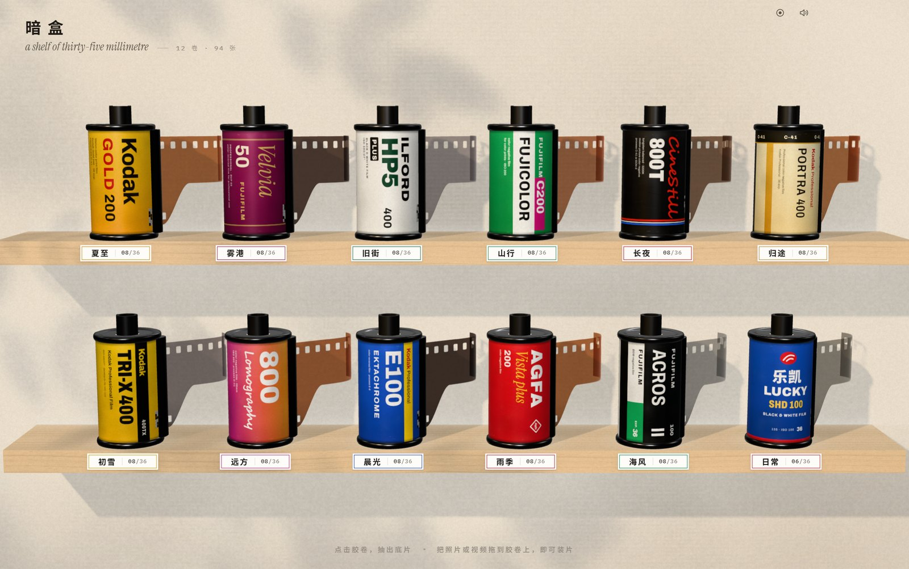
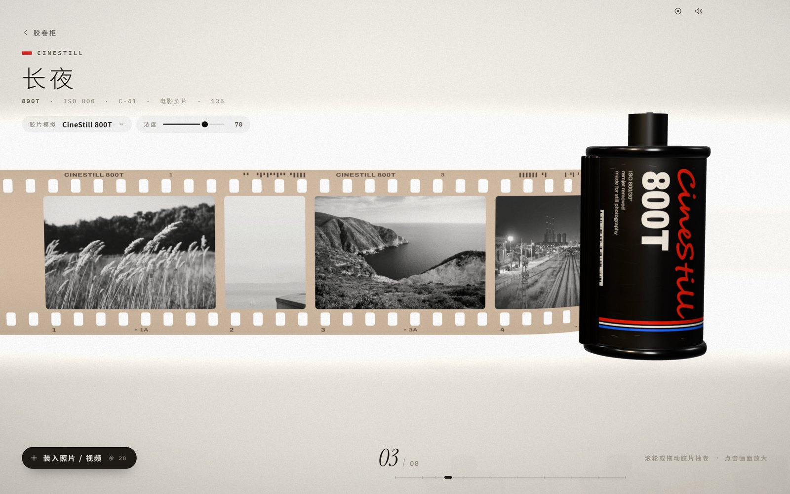
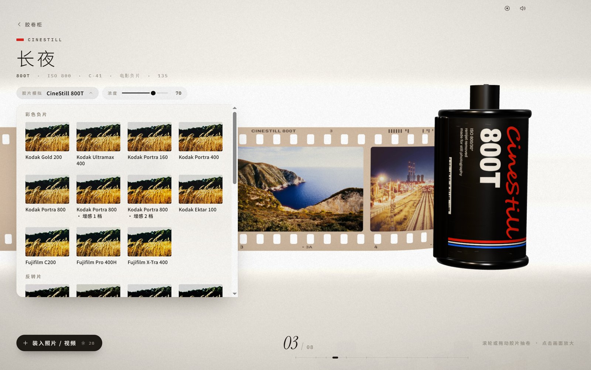
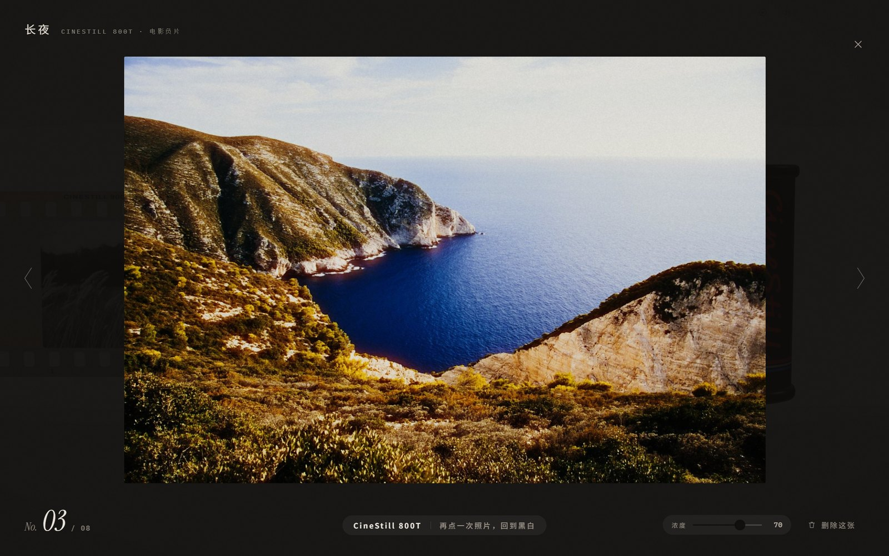

# 暗盒 · ObscuraFilm

一个把照片装进 35mm 胶卷里的桌面相册。照片和视频装进胶卷柜上的十二卷胶卷，抽出底片一格格看；点开一张，它在暗房里从黑白显影成你选的胶片。胶片模拟直接调用 [SpektraLab](https://github.com/JamesQiu2005/SpektraLab) 的光谱引擎，颗粒、光晕、成色剂耦合、放大机滤色都按它算。

A desktop photo album that keeps your pictures on 35 mm film: twelve canisters on a shelf, a strip you pull out frame by frame, and a darkroom where each frame develops from black and white into the film you chose — printed by SpektraLab's spectral film engine, grain and halation included. Windows, Electron + three.js.



| 抽出底片 | 选胶片 |
|---|---|
|  |  |



## 能做什么

- **胶卷柜**：十二卷写实的品牌暗盒（Gold 200、Velvia、HP5、CineStill 800T、Portra 400、Tri-X……），名签可改名，每卷 36 张。
- **装片**：把照片或视频拖到胶卷上即可装入；支持 JPEG / PNG / HEIC（含 Display P3）和常见视频（H.264 / HEVC）。竖图、竖视频占半格，画面永远是正的。
- **抽片**：滚轮或拖动把底片从片口抽出、卷回；片边印着胶片型号、格号和视频时长。
- **暗房**：点一格放大，照片以黑白呈现，再点一下从点击处向外显影成彩色，再点回到黑白。视频打开自动播放。
- **胶片模拟**：25 种胶片（彩色负片、反转片、电影胶片、黑白）加「原色」。每卷有自己的胶片和「浓度」滑条（0 = 原片，100 = SpektraLab 原样成片）。照片由 SpektraLab 引擎渲染（自动测光、颗粒、光晕、散射、成色剂耦合、相纸、眩光），渲染好之前先用由引擎烘焙的 33³ 色表即时预览；视频逐帧实时套色表，加上按引擎实测的颗粒和光晕近似。底片的片基颜色和片边字样也会跟着胶片变。
- **录屏**：标题栏的小圆点或 `Ctrl+Shift+R` 录下软件画面和音效（MP4），录制按钮本身不会出现在成片里。
- 所有照片只存在本机（IndexedDB），不联网。

## 运行

需要 Windows 10/11、Node.js 20+。

```bash
npm install
npm start
```

### 胶片引擎

仓库已内置 SpektraLab 的原生渲染器（`build/runtime/spektralab/spektralab-host.exe` 及其引擎数据，GPL-3.0，源码版本与许可见 [SOURCE.md](build/runtime/spektralab/SOURCE.md)），克隆后直接可用。它需要支持 Vulkan 的显卡驱动；跑不起来时软件照常运行，胶片效果退回色表预览（只有色调，没有颗粒与光晕）。

想换用别的 SpektraLab 版本：把它放在本项目旁边、文件夹名为 `spektralab`，或设置环境变量 `SPEKTRALAB_DIR` 指向它；`npm run pack` 会用它刷新内置的那份。

### 打包

```bash
npm run pack
```

生成 `dist/暗盒-win32-x64/暗盒.exe`，引擎和它需要的数据、许可证一起放进 `resources/spektralab/`。

### 本机设置

项目根目录可放一个 `local.json`（已在 `.gitignore` 中）：

```json
{ "recordingsDir": "D:/录屏/暗盒" }
```

录屏默认保存到「视频\暗盒录屏」；也可用环境变量 `ANHE_REC_DIR` 指定。

## 数据在哪

- 胶卷、照片、改名：`%APPDATA%\暗盒` 下的 IndexedDB。
- SpektraLab 渲染好的成片缓存：`%APPDATA%\暗盒\lab`（约 2 GB 封顶，旧的先删）。

## 开发

- `app/`：渲染进程。`js/app.js` 场景与交互，`film.js` 胶片几何与着色器，`canister.js` / `stocks.js` 暗盒与标签，`lightbox.js` / `grade.js` 放大与显影，`sims.js` 胶片列表与色表，`prints.js` 向引擎要成片，`store.js` 存储，`heic.js` HEIC 解码，`recorder.js` 录屏。
- `main.js` / `preload.js`：主进程（`anhe://` 协议、录屏、标题栏）；`lab.js`：SpektraLab 引擎进程、渲染队列与缓存。
- `build/runtime/spektralab/`：内置的 SpektraLab 渲染器与引擎数据（第三方，GPL-3.0）。
- `tools/capture.js`：无头截图测试脚本；`tools/spektralab/`：重新烘焙 `app/luts` 色表；`tools/fetch-demo.sh`：下载示例照片。

## 许可

本项目以 [GNU GPL v3](LICENSE) 发布。

- 内置的 SpektraLab 渲染器（`build/runtime/spektralab/`）来自 [JamesQiu2005/SpektraLab](https://github.com/JamesQiu2005/SpektraLab) 提交 `2ca735a`，GPL-3.0，未作修改；对应源码与第三方许可见 [SOURCE.md](build/runtime/spektralab/SOURCE.md)。

- `app/luts/*.png` 由 SpektraLab 引擎和 [spektrafilm](https://github.com/andreavolpato/spektrafilm) 的胶片光谱数据生成，按 **CC BY-SA 4.0** 提供，详见 [app/luts/NOTICE.md](app/luts/NOTICE.md)。
- 示例照片来自 Unsplash，按 Unsplash License 使用，作者见 [app/demo/CREDITS.md](app/demo/CREDITS.md)。
- three.js（MIT）、libheif-js（LGPL-3.0）、Archivo / IBM Plex Mono / Instrument Serif 字体（SIL OFL 1.1）等第三方组件见 [THIRD_PARTY_NOTICES.md](THIRD_PARTY_NOTICES.md)。
- Kodak、Fujifilm、Ilford、CineStill、Lomography、Agfa、乐凯等名称和胶卷包装是各自所有者的商标，此处仅用于说明所模拟的胶片，与这些公司无关。
